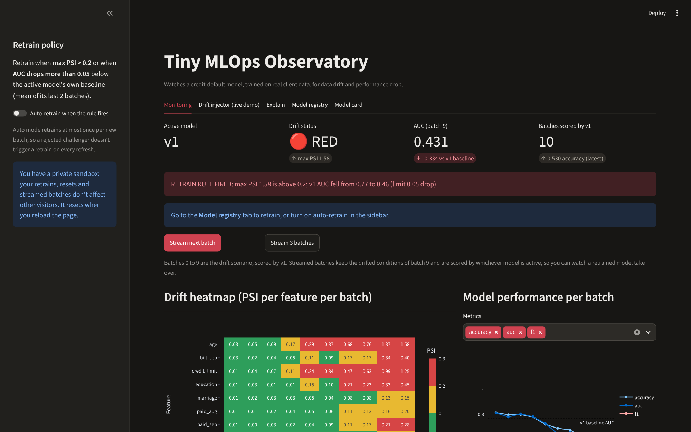
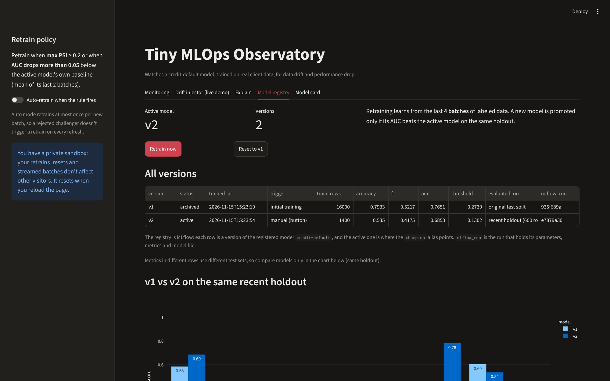

# Tiny MLOps Observatory

A Streamlit dashboard that watches a credit-default model trained on **real data** (30,000 credit card clients), warns when **data drift** or a **performance drop** happens, retrains the model, and compares v1 against v2 before promoting it.

Built from scratch with Python, pandas, scikit-learn, scipy, plotly, Streamlit and FastAPI. The drift tests (PSI and KS) are my own implementation, not a library.

**Live demo:** https://mlops-observatory-sudeepunayak.streamlit.app/

## In simple words

The observatory is a health monitor for a machine-learning model. It watches the model after it is put to work, notices when it starts going wrong, and helps replace it with a better one.

**The model.** It predicts whether a credit card client will miss next month's payment, from their credit limit, age, education, marital status, last three months of repayment status, latest bill and last two payments. It learns from 20,000 real clients.

**The problem.** A model learns from the world as it was, and the world keeps changing. This happens in two ways:

1. **The people change (input drift).** Clients start being older or having lower credit limits than the people the model learned from.
2. **The rules change (concept drift).** Clients look the same, but what makes someone default has changed, for example after an economic shock.

Either way the model quietly gets worse, and nobody notices unless something is watching.

**What the observatory does:**

1. **Sends in new data.** 10 batches of real clients the model has never seen, each a bit more different from the training data.
2. **Checks if the data looks different.** A PSI score per feature shows how far the new data has moved: green (fine), yellow (watch), red (changed a lot).
3. **Checks if the model is still right.** It tracks accuracy and AUC (how well the model separates defaulters from non-defaulters). AUC falls from 0.81 to 0.43, worse than a coin flip.
4. **Sounds the alarm.** If PSI goes above 0.2 or AUC drops more than 0.05, it says "retrain now".
5. **Trains a replacement and keeps it only if it is better.** v2 is trained on recent data and tested against v1 on the same data. It is promoted only if it scores at least as well.
6. **Keeps watching the new model.** New batches are scored by whichever model is active, so you can watch v2 take over and recover. Each model is judged against its own baseline.
7. **Lets you break it on purpose.** Sliders in the Drift injector tab change the data or the rules live, so you can watch the alarms react.
8. **Documents itself.** The Model card tab explains the model's purpose, data and failure modes.

When only the rules change, the data looks normal and PSI stays green while the model fails. That is why the alarm uses both signals (see [Key finding](#key-finding-silent-failure)).

In one sentence: it is a smoke detector for a credit model. It spots when the model's view of the world is out of date, tells you, and safely swaps in an updated model.

## What it does

| Feature | Where |
|---|---|
| PSI heatmap per feature per batch (green / yellow / red) | Monitoring tab |
| Accuracy, AUC and F1 trend lines | Monitoring tab |
| Retrain rule: max PSI > 0.2 or AUC drop > 0.05 | Sidebar and Monitoring tab |
| Live drift injector (input drift and concept drift sliders) | Drift injector tab |
| Stream new batches scored by the active model; "v2 takes over" marker | Monitoring tab |
| Retrain button, auto-retrain, v1 vs v2 comparison, promotion check | Model registry tab |
| Private sandbox per visitor on the live demo | Automatic on Streamlit Cloud |
| Model card with data, limits and failure modes | Model card tab |
| Downloadable drift report (CSV) | Monitoring tab |

## Screenshots






## Key finding: silent failure

When the data **inputs** shift, PSI turns red. When the **rule** that decides default changes (concept drift) but inputs look the same, PSI stays green while AUC falls to about 0.48, worse than random. So the retrain rule uses both signals: PSI as the early warning, AUC as the proof.

## How it works

1. `make_data.py` loads the real dataset and splits it into 20,000 rows for training and 10,000 rows the model never trains on (the stream pool). `make_batch()` draws batches from the pool and can add input drift (resampling real clients, for example more older ones) and concept drift (a share of labels follows a different default rule).
2. `train.py` trains RandomForest v1 (balanced class weights) and saves the model and its reference data.
3. `simulate.py` sends 10 batches of 500 clients with growing input drift. Concept drift starts at batch 4. It logs PSI, KS and metrics per batch.
4. `drift.py` computes PSI and the KS test per feature.
5. `monitor.py` applies the retrain rule to the active model, using only the batches it scored itself and its own baseline AUC. It also streams new batches, which keep the drifted conditions of batch 9 and are scored by the active model.
6. `retrain.py` trains a challenger on the last 4 batches, tests both models on the same holdout, and promotes the challenger only if its AUC is at least as good.
7. `registry.py` keeps a JSON record of every version with metrics and timestamps.
8. `workspace.py` gives each visitor of the live demo a private sandbox, so one person's Retrain or Reset doesn't change what others see. Locally everything stays in the project folder. Set `OBSERVATORY_SANDBOX=1` or `0` to force it on or off.
9. `app.py` is the dashboard.

PSI thresholds: below 0.1 stable, 0.1 to 0.2 watch, above 0.2 drift.

## Run it

```
pip install -r requirements.txt
python make_data.py
python train.py
python simulate.py
python -m streamlit run app.py
```

Run `train.py` again to reset the registry to v1.

## Prediction API

`serve.py` is a FastAPI service that serves the active model:

```
pip install -r requirements-api.txt
uvicorn serve:app --port 8000
```

| Endpoint | What it does |
|---|---|
| `GET /health` | Liveness: the process is up |
| `GET /ready` | Readiness: the active model is loaded |
| `GET /model` | Active version, metrics, features, threshold |
| `POST /predict` | Scores 1 to 1,000 clients. Inputs are validated (ranges, no unknown fields) |
| `GET /monitoring/drift` | PSI and KS of recent requests against the active model's training data |

```
curl -X POST localhost:8000/predict -H 'content-type: application/json' -d '{"clients": [{"credit_limit": 50000, "age": 29, "education": 2, "marriage": 2, "repay_status_sep": 2, "repay_status_aug": 2, "repay_status_jul": 0, "bill_sep": 48000, "paid_sep": 0, "paid_aug": 1500}]}'
```

Interactive docs are at `/docs`. Every scored client is logged to SQLite (`logs/predictions.db`), and `/monitoring/drift` runs the same PSI check as the dashboard on that live traffic. That needs no labels, so it's the early warning in production, where true defaults arrive months later. When a retrain promotes a new version, the API picks it up on the next request without a restart.

## Docker

One image runs either service. Model v1 and the monitoring history are built into the image, so a container serves predictions immediately. It runs as a non-root user and has a health check.

```
docker compose up --build
```

This starts the API on http://localhost:8000/docs and the dashboard on http://localhost:8501. They share a volume, so a model you promote in the dashboard is served by the API on its next request. To run one service on its own:

```
docker build -t observatory .
docker run -p 8000:8000 observatory
docker run -p 8501:8501 observatory dashboard
```

## Scheduled checks and alerts

`check.py` applies the retrain rule to the active model and prints a report. It exits with 1 when the rule fires, so any scheduler or CI system can act on it:

```
python check.py                              # 0 healthy or waiting, 1 alert, 2 the check failed
python check.py --api-url http://localhost:8000 --json report.json --markdown report.md
```

With `--api-url` it also checks live traffic through the API's `/monitoring/drift`.

`.github/workflows/monitor.yml` runs the check every Monday and on demand (**Actions → Scheduled model check → Run workflow**). It keeps exactly one GitHub issue labelled `drift-alert`:

- **Rule fires:** opens the issue with the report, or updates the open one in place, so there's no comment on every run.
- **Model healthy again:** comments with the new report and closes the issue.

The run has two scenarios. `drifted` checks v1 after the 10 drifted batches, so the alert fires. `retrained` retrains, streams 2 batches to the new model and checks again, so it's healthy and closes the alert. Each run rebuilds from the committed data, so the weekly scheduled run checks the drifted scenario and keeps the alert open until you resolve it.

Command-line helpers used by the workflow, also handy locally:

```
python retrain.py               # train a challenger and promote it if better
python monitor.py stream 3      # stream 3 new batches to the active model
```

## Tests

```
pip install -r requirements-dev.txt
ruff check .
python -m pytest
```

The tests cover the prediction API (validation, logging, live drift, picking up a promoted model), the scheduled check, PSI and the KS check, the dataset (including its checksum) and batch sampler, the simulator, the registry and retraining, and a smoke test of the dashboard itself. GitHub Actions runs them on every push and pull request, on Python 3.11 with the oldest supported library versions and on Python 3.13 with the newest. It also builds the Docker image and smoke-tests both containers.

## Results

| | Batch 0 | Batch 9 (drifted) |
|---|---|---|
| AUC (v1) | 0.81 | 0.43 |
| F1 (v1) | 0.60 | 0.17 |
| Max PSI | 0.03 | 1.58 |

v1 scores AUC 0.77 and F1 0.53 on its own test split. Batches are only 500 rows, so batch AUC moves about ±0.03 from noise alone.

After retraining on recent data, v2 reaches AUC 0.67 on the same recent holdout where v1 scores 0.58. On the next three streamed batches v2 scores AUC 0.70 to 0.72 with every feature green again, so the alarm clears.

## Data

The UCI [Default of Credit Card Clients](https://doi.org/10.24432/C55S3H) dataset (Yeh and Lien, 2009), committed as `data/credit_default_raw.csv.gz` so nothing is downloaded at runtime. Source, license and checksum are in [`data/SOURCE.md`](data/SOURCE.md). `SEX` is in the dataset but deliberately left out of the model.

## Limits

- The clients and their default labels are real, but the drift is simulated on top: input drift by resampling real clients, concept drift by relabelling with a different rule. The dataset has no real drift over time to replay.
- The data is from Taiwan in 2005. Today's credit behaviour can differ a lot.
- Baseline AUC is about 0.77, a moderate model. Accuracy is below the 78% you'd get by predicting "no default" for everyone, because balanced class weights trade accuracy for catching more defaulters.
- Performance metrics need true labels, which arrive late for real credit.
- Details are in the Model card tab.

## Next

- Per-feature drift for categorical columns
