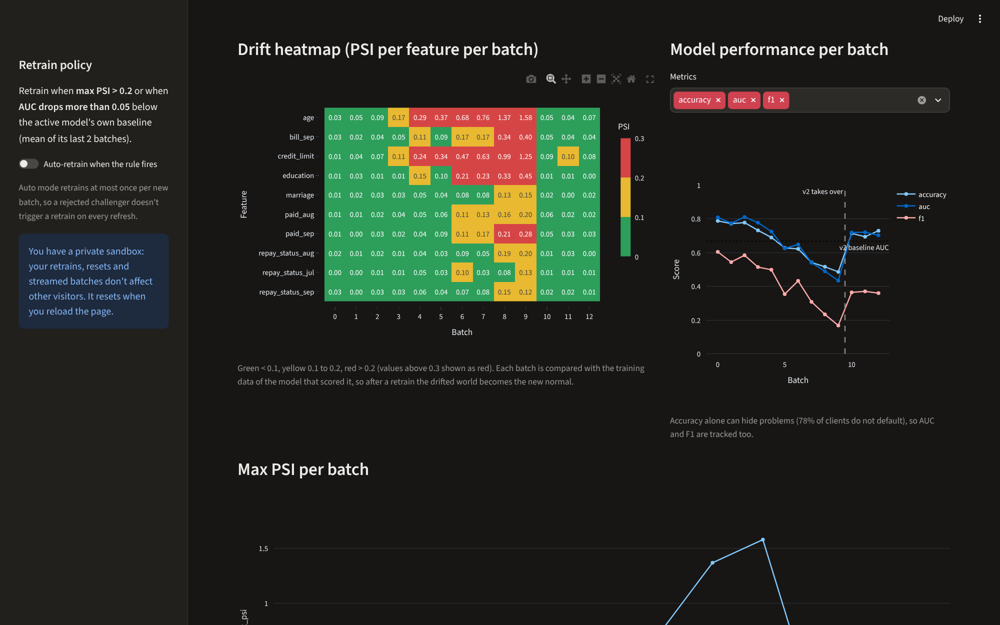
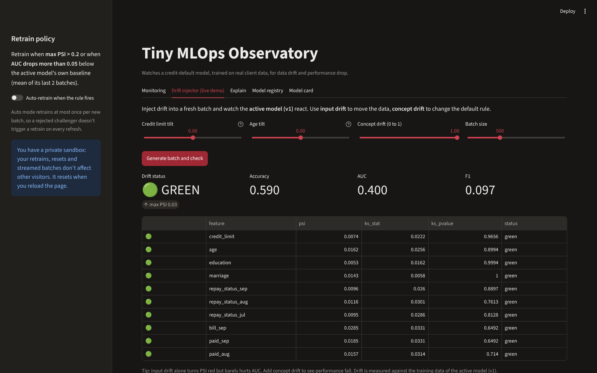

# Tiny MLOps Observatory

A Streamlit dashboard that watches a trained loan-default model, warns when **data drift** or a **performance drop** happens, retrains the model, and compares v1 against v2 before promoting it.

Built from scratch with Python, pandas, scikit-learn, scipy, plotly and Streamlit. The drift tests (PSI and KS) are my own implementation, not a library.

**Live demo:** https://mlops-observatory-sudeepunayak.streamlit.app/

## In simple words

The observatory is a health monitor for a machine-learning model. It watches the model after it is put to work, notices when it starts going wrong, and helps replace it with a better one.

**The model.** It predicts whether a person will fail to repay a loan, from age, income, credit score, debt ratio, loan amount and years employed.

**The problem.** A model learns from the world as it was, and the world keeps changing. This happens in two ways:

1. **The people change (input drift).** Applicants start being older, earning more or asking for bigger loans than the people the model learned from.
2. **The rules change (concept drift).** Applicants look the same, but what makes someone default has changed, for example after an economic shock.

Either way the model quietly gets worse, and nobody notices unless something is watching.

**What the observatory does:**

1. **Sends in new data.** 10 batches of new applicants, each a bit more different from the training data.
2. **Checks if the data looks different.** A PSI score per feature shows how far the new data has moved: green (fine), yellow (watch), red (changed a lot).
3. **Checks if the model is still right.** It tracks accuracy and AUC (how well the model separates defaulters from non-defaulters). AUC falls from 0.70 to 0.43, worse than a coin flip.
4. **Sounds the alarm.** If PSI goes above 0.2 or AUC drops more than 0.05, it says "retrain now".
5. **Trains a replacement and keeps it only if it is better.** v2 is trained on recent data and tested against v1 on the same data. It is promoted only if it scores at least as well.
6. **Lets you break it on purpose.** Sliders in the Drift injector tab change the data or the rules live, so you can watch the alarms react.
7. **Documents itself.** The Model card tab explains the model's purpose, data and failure modes.

When only the rules change, the data looks normal and PSI stays green while the model fails. That is why the alarm uses both signals (see [Key finding](#key-finding-silent-failure)).

In one sentence: it is a smoke detector for a loan model. It spots when the model's view of the world is out of date, tells you, and safely swaps in an updated model.

## What it does

| Feature | Where |
|---|---|
| PSI heatmap per feature per batch (green / yellow / red) | Monitoring tab |
| Accuracy, AUC and F1 trend lines | Monitoring tab |
| Retrain rule: max PSI > 0.2 or AUC drop > 0.05 | Sidebar and Monitoring tab |
| Live drift injector (input drift and concept drift sliders) | Drift injector tab |
| Retrain button, auto-retrain, v1 vs v2 comparison, promotion check | Model registry tab |
| Model card with data, limits and failure modes | Model card tab |
| Downloadable drift report (CSV) | Monitoring tab |

## Screenshots





## Key finding: silent failure

When the data **inputs** shift, PSI turns red. When the **rule** that decides default changes (concept drift) but inputs look the same, PSI stays green while AUC falls to 0.43, worse than random. So the retrain rule uses both signals: PSI as the early warning, AUC as the proof.

## How it works

1. `make_data.py` generates synthetic loan data. `make_loans(concept=0..1)` can change the default rule.
2. `train.py` trains RandomForest v1 and saves the model and its reference data.
3. `simulate.py` sends 10 batches of 500 rows with growing input drift. Concept drift starts at batch 4. It logs PSI, KS and metrics per batch.
4. `drift.py` computes PSI and the KS test per feature.
5. `retrain.py` trains a challenger on the last 4 batches, tests both models on the same holdout, and promotes the challenger only if its AUC is at least as good.
6. `registry.py` keeps a JSON record of every version with metrics and timestamps.
7. `app.py` is the dashboard.

PSI thresholds: below 0.1 stable, 0.1 to 0.2 watch, above 0.2 drift.

## Run it

```
pip install -r requirements.txt
python make_data.py
python train.py
python simulate.py
python -m streamlit run app.py
```

Run `train.py` again to reset the registry to v1.

## Results

| | Batch 0 | Batch 9 (drifted) |
|---|---|---|
| AUC (v1) | 0.70 | 0.43 |
| F1 (v1) | 0.38 | 0.11 |

After retraining on recent data, v2 reaches AUC 0.68 on the same recent holdout where v1 scores 0.51.

## Limits

- The data is synthetic, so numbers show how the system behaves, not real lending performance.
- Baseline AUC is about 0.69, a moderate model.
- Performance metrics need true labels, which arrive late for real loans.
- Details are in the Model card tab.

## Next

- Swap in a real Kaggle loan default dataset
- Scheduled monitoring and alerts
- Per-feature drift for categorical columns
